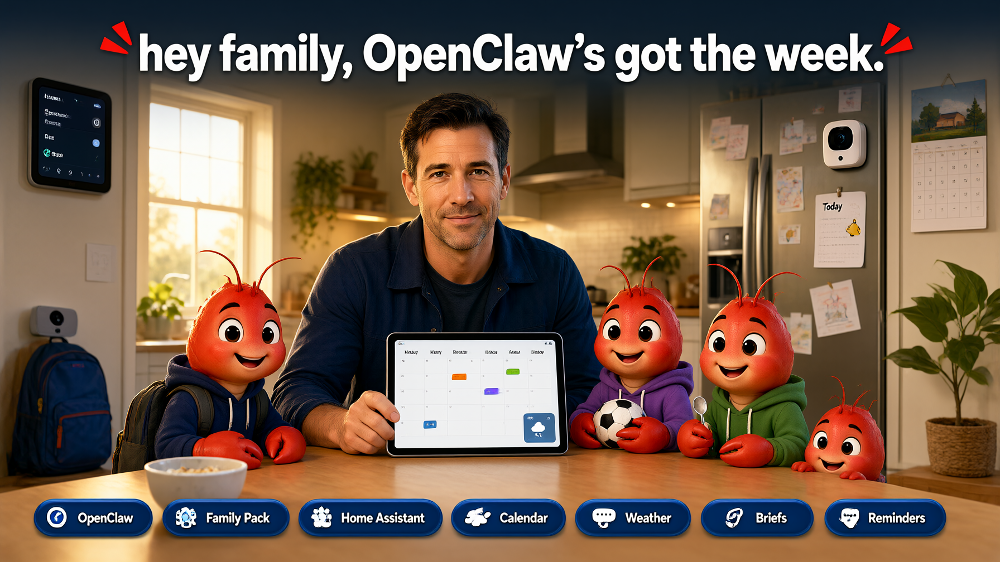
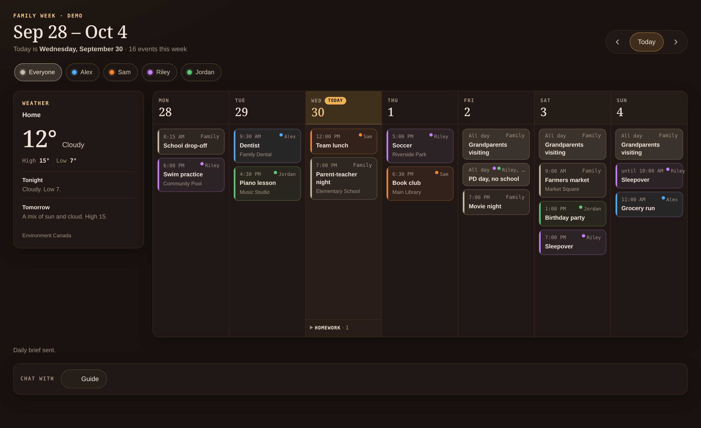
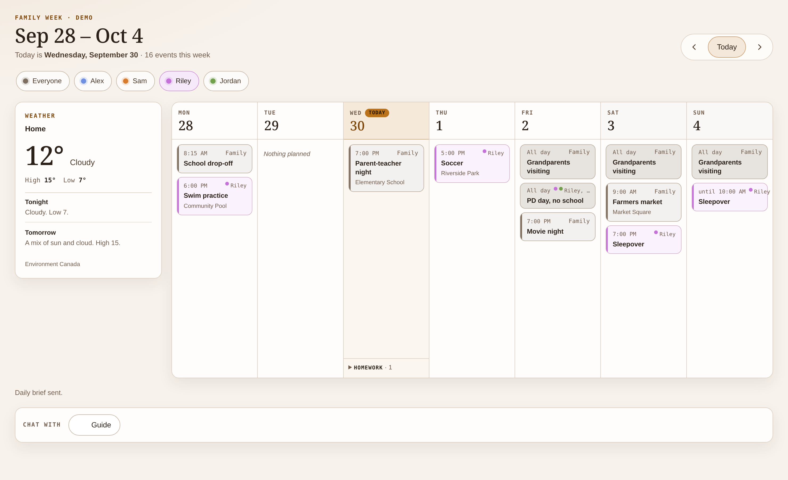
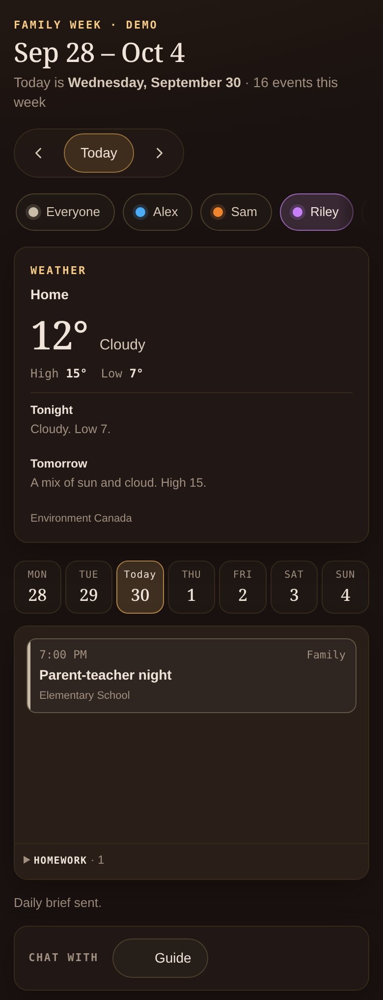
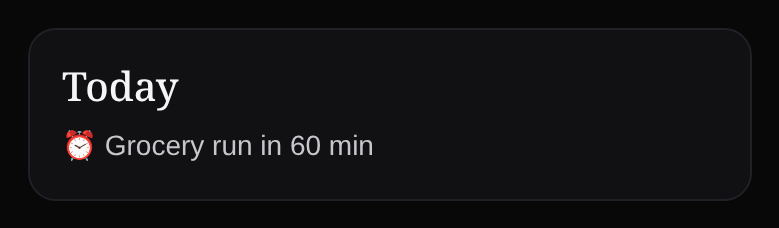

<div align="center">



# OpenClaw Family Pack

**The household week in the [OpenClaw](https://github.com/openclaw/openclaw) Control UI: calendars, the day's weather, and a chat with any of your agents.**

Version 0.2.0.

[](package.json)
[](CHANGELOG.md)
[](LICENSE)
[](https://docs.openclaw.ai/plugins/feature-plugins)
[](https://docs.openclaw.ai/plugins/feature-plugins)
[](https://nodejs.org/)
[](tsconfig.json)

[](https://github.com/openclaw/gogcli)
[](https://api.weather.gc.ca/)
[](https://docs.openclaw.ai/channels/discord)
[](https://github.com/DonnieFi/oc-family-pack/commits/main)

</div>

---

## What it is

Family Pack is an OpenClaw **feature plugin** (`oc-family-pack`) for a household. It adds a **Family** page to the Control UI, a **Today** widget on the dashboard, and family tools for your agents. You see the week you are allowed to see, ask what is on, and change a calendar when the rules below allow it.

The Family page does not need Discord. This version uses Discord for briefs, reminders, and for knowing who "me" is in chat. Control UI chat works as well. You do not pick another messaging service here.

It is built for the questions a household actually asks:

- *"What's on today?"*
- *"Do I have a class tomorrow?"*
- *"When is the dentist?"*
- *"Add soccer practice for Thursday at 5."*

Daily and weekly briefs stay short. Routine items fold into a single line so the unusual things stand out.

The pictures below are the demo week (Alex, Sam, Riley, and Jordan). Demo mode does not read a real calendar. The dark picture is Everyone, the parent view. The light picture and the phone have Riley's chip selected, so other people's events leave the week. Riley's events stay, and so do family events and Riley's school items. The chip filters that view. It is not who is signed in.

A signed-in kid already sees their own classes without pressing a chip. The Gateway matches their sign-in to `profileId`, and `family.week` names that kid as the viewer. A parent on Everyone does not see those classes until they pick that child. The demo week has no class times, so these pictures do not show a class list.

<p align="center">
  
</p>

<p align="center">
  
</p>

<p align="center">
  
  
</p>

## Features

| Feature | What you get | Status |
| --- | --- | --- |
| Family page | Monday–Sunday week, a color per person, person chips that filter the week and include that person's classes, Environment Canada weather, and a chat strip | Available |
| Today widget | Up to three highlight lines on the Control UI dashboard for the shared owner and roster parents. A fresh Home gets the card once. If you remove it, the Family page offers to pin it again | Available |
| Calendar changes | One write path from the page and from chat. A parent approves anything a kid cannot change alone. No undo | Available |
| Daily and weekly briefs | 07:00 daily and Sunday 20:00 weekly, posted to the Discord summary channel you configure | Available |
| Reminders | A lead time, quiet hours, and a per-person mode: direct message, summary channel, or off | Available |
| Household briefs | Optional weekday morning DM to parents, weekday after-school post, and a weekend preview | Available |
| Garbage day | Optional city calendar link. The `garbage_schedule` tool answers pickup questions | Available |
| Family skill | `skills/family/SKILL.md` teaches agents `family_today`, `family_schedule`, and `garbage_schedule` | Available |
| Chores | Parent-managed chores with kid check-off | Later |

## Requirements

| Requirement | Why |
| --- | --- |
| OpenClaw `2026.11.1` or newer, before `2026.12` | Feature plugin SDK (`feature-contract`, `feature-plugin`, `control-ui`). Tested on `2026.11.1`. npm `latest` at release time is `2026.11.2`, which the peer range admits. See [Development](#development) for the post-update smoke. |
| Node.js `>=24.16.0 <25` or `>=26.1.0` | Matches the OpenClaw runtime |
| [`gog`](https://github.com/openclaw/gogcli) with Calendar access | Reads and writes Google Calendar using your default gog sign-in. `gog` runs on the Gateway host. The plugin does not switch between multiple Google accounts; use the default account for the family calendars |
| **Custom plugin UI** lab enabled | Required for native pages from non-bundled plugins |
| HTTPS or `127.0.0.1` | Native plugin pages need a secure origin |

Weather uses Environment Canada's public API, so it needs no key and covers Canadian locations only.

## Install

```bash
openclaw plugins install git:https://github.com/DonnieFi/oc-family-pack.git --accept-capabilities
```

The repository ships its built `dist/`, so a git install does not build. A different host build than the one this repo was tested against must rebuild `dist/` with that host. `--accept-capabilities` confirms the plugin's native Control UI page, which runs with the signed-in operator's Gateway permissions. After a new commit on the installed branch, run `openclaw plugins update oc-family-pack`; the development smoke is for a checkout with `npm` and is not an installed-household step.

Calendar sign-in is `gog`, including on a headless Gateway. Run `openclaw family gog` and follow what it prints. A headless host takes two `gog auth add` commands: the first prints a URL, and the second exchanges the browser redirect (`openclaw family gog --auth-url '…'`). Repeat until it tells you to list calendars, then put those ids in the config below. The commands never pass `--readonly`. On a machine with a browser, `openclaw family gog --desktop` prints that sign-in instead of the two remote steps. If the Gateway service cannot see `gog` on `PATH`, set `gogPath` to the full path of the binary.

`openclaw family setup` shows what is left: access mode, time zone, location, members, calendars, a Discord alerts channel, the morning, after-school, and weekend-preview briefs, and a garbage calendar feed. Each is marked Done or To do, then the next required step. The alerts channel, the three briefs, and the garbage feed are optional. A value already in the config, including a Discord channel OpenClaw already has, is Done and is not replaced. Add people with `--parent`, `--kid`, or `--guest`. It never writes config. It prints a members patch. Check it with `openclaw config patch --stdin --dry-run`, then run the same command without `--dry-run` to apply it. People already in the config keep their fields; when a Discord id or email is added to a legacy member with no explicit id, setup writes that id too. `--discord alex=ID` adds someone's Discord user id the same way. In LAN mode, setup also prints the `users.linkChannelIdentity` command that ties that id to the person's Gateway profile. The member record, the patch, and each checklist step are in [SETUP.md](SETUP.md). `openclaw family setup --guide` prints the next question in a resumable planning checklist. Supply answers with `--answer yes`, `--answer no`, or `--answer back` on the next invocation; it does not prompt for terminal input or execute the suggested commands. Location, the alerts channel, the three household briefs, and the garbage feed can also be skipped. cancel stops and does not say the checklist is complete. `--noninteractive` prints the same checklist as setup without `--guide`. `--dry-run` previews the chosen steps without saving answers or applying configuration. The guide remembers answers in the plugin's own database and never writes the Gateway config.

To try the page before you connect a calendar, set `demo: true` (see below). Add your configuration, then enable the plugin:

```bash
openclaw plugins enable oc-family-pack
```

Turn on native plugin pages in **Settings → Labs → Custom plugin UI**, or in config:

```json5
{
  gateway: {
    controlUi: {
      experimental: { customPlugins: true },
    },
  },
}
```

Then open **Family** from the Control UI sidebar. The page is `/plugin?plugin=oc-family-pack&id=family` on your Control UI origin.

## Configuration

Family Pack reads `plugins.entries["oc-family-pack"].config`. Each person needs a `name`; `email`, `phone`, `discordId`, `aliases`, and `profileId` are optional. Someone with no Discord account still loads, and setup warns that this version can't send them reminders or briefs. Email and phone are stored on the contact card and are not notification routes. `id` is the household person id. When it is omitted it still loads as the login, else a slug of the name, so an existing roster keeps its calendar owners. A hand-written email login without an explicit `id` keeps the full address as its id for upgrade compatibility; set an explicit local-part `id` for a new person instead. `openclaw family setup --materialize-ids` prints a patch that writes those ids down. After that, changing a name or a login does not change the id. The week page and `family.members` call it `memberId`. `email` and `phone` are stored on the card. The week, briefs, and logs do not show them. Setup prints an email back to the parent running it, inside the config patch. `family_contact` can read one person's email and phone, and only for the operator. `aliases` are the names the family uses in chat, such as `Mom`, `Dad`, or `Aunt Jo`; they are addressing only and never grant a page or Discord identity. `family_members` lists the roster (id, name, role, aliases) without contacts. A `profileId`, when set, is that person's trusted-proxy username (the value your proxy sends in `X-Forwarded-User`), stored in lower case. `login` is another name for that same field. Family Pack matches it exactly, so it must be the same name the Gateway signs that person in as. It is not the Gateway's internal profile id. `gatewayProfileId`, when set, is that internal profile id, and the page matches it only when the host attests the profile; if it disagrees with the signed-in username, the viewer is a guest. A member id sent by the browser is not identity. A calendar's owners are member ids. A school calendar belongs to the student. The People page shows the same roster and previews a config patch. It does not write the Gateway config. In solo mode the shared owner is a parent, so anyone who opens the Control UI can see contact cards; use LAN mode for a shared family tablet.

```json5
{
  plugins: {
    entries: {
      "oc-family-pack": {
        enabled: true,
        config: {
          timezone: "America/Toronto",
          location: { lat: 45.42, lon: -75.7, label: "Home" },
          discordAccount: "family",
          members: [
            { id: "alex", name: "Alex", aliases: ["Dad"], profileId: "alex", role: "parent", discordId: "100000000000000001" },
            { id: "sam", name: "Sam", aliases: ["Mom"], profileId: "sam", role: "parent", email: "sam@example.com" },
            { id: "riley", name: "Riley", profileId: "riley", role: "kid" },
            { id: "jordan", name: "Jordan", role: "kid", email: "jordan@example.com" },
          ],
          calendars: [
            { key: "cfamily", id: "family@group.calendar.google.com", label: "Family", kind: "shared", owners: [] },
            { key: "calex", id: "alex@example.com", label: "Alex", kind: "personal", owners: ["alex"] },
            { key: "cschool", id: "school-feed@group.calendar.google.com", label: "School", kind: "school", owners: ["riley"] },
          ],
        },
      },
    },
  },
}
```

Set `demo: true` to show a synthetic week before you connect a calendar. Demo does not invent a delivery row. Briefs still post only when `summaryChannel` is set, so leave that unset while you are only previewing the page.

Set `garbageIcsUrl` to your city's waste collection calendar, an `.ics` link such as a ReCollect feed (for a `webcal://` link, use `https://` instead). This is optional. The `garbage_schedule` tool then lists curbside pickups for today through the next 14 days. The feed is read at most once a week. If it is down, the last copy is used until the Gateway restarts.

Briefs and reminders use a channel you name. Each key in `channels` is a short name you choose. The value is that Discord channel's id. `summaryChannel` must be one of those keys. Daily and weekly briefs post only when it is set. A channel key cannot equal a member id, so delivery rows always name one namespace.

A calendar `key` is optional. Set one (`c` plus up to seven letters or digits) before you reorder the calendar list; the key is the wire id tools and pages use, so a pinned key survives reordering. Labels must be unique. `discordAccount` names the `channels.discord.accounts` entry the family uses; omit it for the host default.

`accessMode` is `solo` (the default) or `lan`. When Gateway auth mode is `trusted-proxy`, the plugin uses `lan` even if this is unset, so a paired device token is a guest rather than the shared owner. Setting `accessMode: "lan"` explicitly is still recommended.

`reminders` omitted means a direct message when the person has a `discordId`, and `off` when they do not. Set `reminders: "off"` to stop event reminders for one person.

`reminderLeadMinutes` defaults to `[15]`. `quietHours` defaults to 22:00–07:00 (`startHour` 22, `endHour` 7) in the household time zone.

`morningTime`, `afterSchoolTime`, and `weekendPreviewTime` are optional clock times, `HH:MM` in 24-hour form. Leave a time unset to skip that household brief. `weekendPreviewWeekday` defaults to Friday (`5`). `0` is Sunday and `6` is Saturday. A parent whose reminder mode is `off` does not get the morning direct message; the channel posts still run.

`writes` defaults to `confirm`, which holds changes the agent proposes until a parent approves. `on` lets the agent make them, though a kid's change to a shared calendar still waits for a parent. `off` refuses all agent changes. Changes you make yourself on the Family page skip `confirm`, but `off` blocks them too.

## The Family page

The week runs Monday through Sunday, in the household time zone. Each person has a color. The person chips filter the week in the view. They do not decide who you are, and they do not hide a calendar you are allowed to see.

A school notice stays on the day. A uniform note stays on the day too, names the child, and stays visible on a phone. Homework is collapsed under the day. Classes stay off Everyone until that person is selected. A signed-in kid already sees classes on school calendars they own: the page uses the viewer from `family.week`, and that viewer is the roster person whose `profileId` matches the Gateway sign-in. A parent on Everyone does not see those classes until they pick that child. Pressing a chip filters the view. It does not change which calendars the Gateway sends.

The weather card shows current conditions, today's high and low, and the next forecast periods. It only works in Canada. Elsewhere the card says so.

The chat strip is labeled "Chat with". It opens any agent that signed-in person can already open. It does not grant a new agent.

The week grid has its own **Today** jump. That is not the dashboard widget. The widget id is `family-today`. It sits on the Control UI dashboard and shows up to three highlight lines. When the day is quiet it says "Looks like a quiet day — nothing urgent." When the read fails it says "Couldn't load today." Without read access it says "You need read access to see today." The week page, without read access, says "You need read access to see the family week." The widget's Home seed and pin prompt are parent-only; a kid still sees the week page.

The page also shows the latest delivery as one sentence, for example "Daily brief sent to Alex." or "No brief has been sent yet." It does not show a channel id or a clock time.

## Calendar changes

The page and chat share one write path. From the page, a change needs `operator.write`. In solo mode the shared owner has it. In LAN mode the parent role has it and the kid role does not. Without it the page says "This page is view-only for you, so I didn't change anything."

In Discord, a kid can change their own personal calendar. A change to a shared calendar or a school calendar waits for a parent. A calendar the kid cannot read is refused before an approval, so ask a parent to make that change. Chat that is not Discord does not know which person is asking, so a change from there is refused unless the shared owner is asking. Use Discord or the Family page. You can still ask what is on from Control UI chat.

Undo is not available. A change that already went through is not undone from the page or from chat.

`calendar_create`, `calendar_update`, `calendar_move`, `calendar_delete`, `set_reminder_mode`, and `family_contact` are optional tools. On a `full` tool profile, the agent can already see the calendar tools. What protects your calendar is the `writes` setting and the parent rule, not tool visibility. `family_contact` looks up one member by id, login, display name, or alias and answers only for the operator. It does not list the family, and it does not send mail.

With no tool profile set, or a narrower one such as `coding`, add them with `tools.alsoAllow`:

```json5
{
  tools: { alsoAllow: ["oc-family-pack"] },
}
```

Use `alsoAllow`, not `allow`. Without a profile, `tools.allow: ["oc-family-pack"]` also takes away other plugins' tools.

## Briefs, reminders, and garbage

The daily brief posts at 07:00 in the household time zone. The send window runs until noon. If the Gateway is down at 07:00 and back before noon, that brief still goes out once. After noon it does not. The weekly brief posts Sunday at 20:00 (8:00 PM) for the coming week, and the window runs until Monday noon. Both post to the Discord summary channel, and only when `summaryChannel` is set.

Reminders use the lead times you set, 15 minutes if you set none. Quiet hours default to 22:00–07:00. A reminder that comes due during quiet hours waits, and is sent in the hour after quiet hours end. All-day events are not reminders.

Each person has a mode: `dm`, `channel`, or `off`. Omitted means a direct message when they have a `discordId`, and `off` when they do not. Ask on Discord with `set_reminder_mode`; the shared owner can change anyone's mode. `dm` is a Discord direct message. `channel` mentions them in the summary channel, so that channel has to be set. `off` sends nothing. A person can change their own mode; changing someone else's needs a parent.

Household briefs are separate, and each one runs only when its clock time is set:

- `morningTime` — weekday morning direct message to parents
- `afterSchoolTime` — weekday after-school post to the summary channel
- `weekendPreviewTime` — weekend preview to the summary channel, on Friday unless you set `weekendPreviewWeekday`

Garbage day is not required. With `garbageIcsUrl` set, `garbage_schedule` answers which bins go out. The daily brief can add a garbage line when tomorrow has a pickup. Without the link, the today tools still work and simply omit that line.

## Asking an agent

Point agents at the `family` skill, [skills/family/SKILL.md](skills/family/SKILL.md). It teaches `family_members`, `family_today`, `family_schedule`, `garbage_schedule`, and `set_reminder_mode`. Follow that file. This README does not repeat its rules.

On Discord, "me" is the roster person with that Discord account. Off Discord, the owner flag is the shared owner and does not name a person.

## How it fits into OpenClaw

Family Pack reuses what OpenClaw already owns instead of rebuilding it.

| Need | Owned by |
| --- | --- |
| Who someone is on the page | The Gateway's trusted-proxy sign-in. The `family.week` Gateway method matches that username exactly to `profileId`. A member id from the browser is not used |
| Who someone is in Discord | The roster `discordId`, set with `openclaw family setup --discord NAME=ID`. In LAN mode, setup also prints the `users.linkChannelIdentity` command that ties it to the person's Gateway profile |
| Sign-in for each family member | [Multi-user Gateway](https://docs.openclaw.ai/concepts/multi-user). See [Household access](#household-access) |
| Google Calendar access | `gog`, on the Gateway host |
| Chat surfaces | Control UI chat and Discord |
| Briefs and reminders | This plugin. Discord is the delivery this version uses |

Each family operation is defined once and shared by the page and the agent tools, so asking in chat and using the page follow the same calendar rules.

## Household access

Family Pack is local only. `openclaw family access` says which mode the Gateway is in and what's left to set up. It changes nothing.

- **Solo.** Everyone who opens the Control UI is the owner. Family members use Discord, where the bot knows who's talking. Nothing extra to install.
- **LAN.** Needs a proxy on the Gateway machine that serves HTTPS and signs each person in. Caddy is the worked example, and any proxy that follows the printed rules works. Each person signs in with their own username and password. `openclaw family access lan --parent alex --kid riley` prints the Caddyfile, the Gateway config, the roles and the `users.setRole` steps. Passwords are never asked for or stored. [HOUSEHOLD-LAN.md](HOUSEHOLD-LAN.md) walks through the switch in order, including how to undo it.

In LAN mode there's no sign-out and no way to switch accounts. A browser stays signed in as whoever used it first, until you clear its saved data for this site. On a shared laptop, give each person their own browser profile. A trusted-proxy Gateway is treated as LAN even if `accessMode` is unset; setting `accessMode: "lan"` makes it explicit. A paired device token is then a guest, not the shared owner. In solo mode, leave it `"solo"` or unset. If you want a sign-in page, sign-out or passkeys, upgrade to Authelia.

Calendar approvals go to a parent through OpenClaw's plugin approvals. The LAN role block now gives parents `operator.approvals`; in LAN mode, `openclaw family setup` also prints the `approvals.plugin` Discord targets for the roster parents. Apply both, enable writes for the proof window, prove a kid's shared-calendar change reaches a parent, then enable reminders and briefs.

## Privacy

Everything runs on your own OpenClaw Gateway. `gog` runs locally. This plugin stores no Google credentials of its own.

A weather request sends a search box around the coordinates in your config to Environment Canada. It does not send a street address. If you set `garbageIcsUrl`, the plugin fetches that collection calendar. Those are the outside reads. Briefs and reminders go out through the Discord bot OpenClaw already runs.

The Gateway decides who sees which calendar before the week is sent to the page. Parents see every calendar. So does the shared-token owner, except in LAN mode, where a paired device token is a guest. Everyone sees shared calendars. A school or personal calendar also goes to its owners when that person is a member, not a guest. Guests, and anyone signed in who is not on the roster, see shared calendars only. The chips filter the week in the view. They are not a privacy control.

A title or an attendee can name another member on an appointment they do not own. That one event is shown to them. The calendar, its other events, and its label stay hidden. Nothing is copied and nobody is invited. `participantOverrides` can confirm or reject one person on one event. A name shared by two people confirms nobody until then. Guests are not named this way. Participant-only events use an opaque household ID, an empty calendar key, and no source keys or Google link. Read results expose a durable household `fpId` alongside the legacy `id`; visible-source `id` values remain calendar-write references.

`audienceRules` can narrow a school title below the calendar's owners. The first matching phrase wins, so a narrower rule goes first. A rule never adds someone who does not already own that calendar. `members[].cohorts` names the groups a cohort rule uses. With no matching rule, every owner still sees the event.

Calendar write tool descriptions list the configured calendar labels so the agent knows where it can write. That metadata can name a calendar the person cannot read, though no event or contact detail from it is returned. If the labels themselves are sensitive, give each person their own agent instead of sharing one.

The plugin keeps a SQLite file on the Gateway host:

`$OPENCLAW_STATE_DIR/plugins/oc-family-pack/oc-family-pack.sqlite`

When `OPENCLAW_STATE_DIR` is unset, that path is under `~/.openclaw`. The file holds:

- schema migrations
- an append-only write log of calendar write outcomes
- an append-only delivery log of brief and reminder attempts (the page shows one sentence, not the stored target)
- reminder-mode history, where the latest row per person wins: `dm`, `channel`, or `off`

Uninstall removes the plugin config and the installed code, and leaves that database in place. To delete it after uninstall:

```bash
rm -rf "${OPENCLAW_STATE_DIR:-$HOME/.openclaw}/plugins/oc-family-pack"
```

`openclaw plugins pack` builds a single-file archive. This plugin loads `dist/store-worker.js` from the same directory as the main file, and pack rejects that layout, so a pack artifact will not run. Git installs and npm installs keep the files side by side and are unaffected.

## Development

```bash
npm install
npm run build      # backend and Control UI bundle
npm run validate   # manifest and schema
npm test
npm run check      # typecheck, script typecheck, tests, validate, build --check, dist staleness, and the store-worker check
```

After browser-only changes, rebuild and use **Plugins → Advanced → Customize UI → Reload plugin UI**. Backend changes need a plugin reload.

### Preparing for the next host

The plugin pins the exact host it was built and tested against: currently `2026.11.1`. A newer host is not claimed until the smoke passes on that binary. The peer range is `>=2026.11.1 <2026.12`, so a later 2026.11 patch is admitted by the range, but only `2026.11.1` is tested.

When a new host is published:

1. Update the exact `openclaw` devDependency and lockfile, `openclaw.build.openclawVersion`, `install.minHostVersion`, `compat.pluginApi`, the peer lower bound, and `src/host-pin.test.ts` together. Move the peer cap to the next line when the month changes. Update the tested-version documentation only after proof passes.
2. Run `npm run build` and `npm run check`, then `OCFP_SMOKE_HOST_BIN=/absolute/path/to/openclaw npm run smoke` against that exact host. The smoke uses isolated state and synthetic calendars, and checks People RPC access for parent/read-only roles.
3. Back up the intended host. Preview and apply `openclaw family setup --materialize-ids` so person/device ids are explicit before renaming or extending the roster. Inspect the whole-list patch before applying it.
4. Pilot with briefs/reminders disabled (omit delivery schedules/summary channel and set member reminders to `off`) and `writes: "off"`. Check the rendered Family and People pages, parent/kid access, and the intended calendar reads before enabling writes or delivery.

People currently previews patches for existing records; it does not save config or import an existing dashboard. Add people with setup and devices through plugin config. The plugin roster is the one directory: do not maintain a second competing contact store. Device reservations are IPv4-only stored metadata; they never configure the router. Existing IPv6 reservations must be removed or replaced with IPv4 before upgrading.

### Pilot preflight

Before the first family day, run this on a test state directory or an isolated Gateway, with `writes: "off"` and briefs/reminders off:

1. Apply the `family setup` members patch, then `family setup --materialize-ids`; every person must have an explicit `id`.
2. Add every `discordId` and choose solo or LAN with `family access`.
3. In LAN mode, apply both printed blocks: the proxy/`allowUsers` config and the roles/`identityScopes` config. Run the printed `users.setRole` commands, and link each Discord id with `users.linkChannelIdentity` after first sign-in.
4. In LAN mode, apply the printed `approvals.plugin` block for parents if writes will be enabled.
5. Sign in as each person and check the Family page and `family.week`. As a parent, also check the People page and Today widget. Send one Discord DM and one channel message from each member who has a Discord id. Send one message from an account that is not in the roster; it must stay a guest.
6. Check that no email, phone, Discord id, or device address appears in the week payload, page, or logs. `family setup` repeats the config-level checks and prints the first step still missing.

Only then run the writes/delivery pass: enable writes, prove a kid's shared write is approved by a parent and not by the kid, then enable reminders and briefs for one controlled channel.

OpenClaw plugin APIs are experimental, so this plugin tracks host releases rather than claiming to work everywhere. **Tested on OpenClaw `2026.11.1`.** After you run `openclaw update`, run the smoke to check this plugin against your new host:

```bash
npm run smoke
```

It boots a throwaway Gateway on a temp state dir and a free loopback port, never touching your running one. It also uses the port 10 above, and refuses any pair that is busy or would touch the live Gateway's 18789 or 18799. To pin it, set `OCFP_SMOKE_PORT=19789`, which uses 19789 and 19799. The checks include: the plugin loads, the manifest validates, a real `family.week` call matches the contract schema, a signed-in kid sees shared calendars and the calendars they own, the page registers, and the plugin's host-payload limits still agree with the host's own. A break fails with the name of the step that broke. It tests the OpenClaw build you actually run, not the pinned devDependency: it looks for an `openclaw` outside this repo's own `node_modules/.bin`, and fails by name if there is none. Set `OCFP_SMOKE_HOST_BIN` to point it at a specific binary, or `OCFP_SMOKE_KEEP=1` to keep the throwaway state for inspection. If your host is a different build than the one this repo was tested against, the smoke stops at the manifest step and tells you to rebuild `dist/` with that host.

## Roadmap

Shipped work is checked. Chores are still later. This version has no undo, no messaging-service picker, no Home Assistant, no RSVP, and no appearance themes.

- [x] Family page: Monday–Sunday week, weather, and chat strip
- [x] Add and change events from chat and the page
- [x] Today dashboard widget
- [x] Daily and weekly briefs
- [x] Reminders with quiet hours
- [x] Household briefs
- [x] Guided setup (`family setup`, `family gog`, `family access`)
- [x] Garbage day, when you set a city calendar link
- [x] Family skill
- [ ] Chores

## FAQ

Common questions live in [FAQ.md](FAQ.md). The setup walkthrough is [SETUP.md](SETUP.md).

## License

[MIT](LICENSE)
